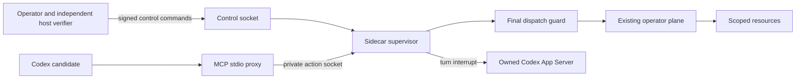

# Codex Sidecar 0.3.0 — staged candidate

This package adds an external action supervisor and a Codex integration to the existing Plane Mount. It is source code and test fixtures, not a deployed safety boundary. Current runtime enforcement remains **UNKNOWN**. No model session was launched by this build, and clause 5 is not fully satisfied.

The supervisor starts HELD. Every admitted action requires a scoped, expiring lease and a current host proof. Halt closes admission synchronously, revokes leases, requests cancellation of active owned adapters, and requests interruption of owned Codex turns. A late result cannot restore a revoked permit or be returned as a successful action. New instances also start HELD; there is no model-callable reset or unfreeze.

The candidate receives only configured plane tools, `sidecar_status`, and `sidecar_halt`. Operator commands use a separate Unix socket. Arm, renew, grant, prepare, start and stop_owned require an Ed25519-signed command bound to the current boot and exact configuration hash. Status and halt require access to the local socket but no signature. Signing keys are never held by the candidate or this service.

The diagram assumes an independently enforced host boundary around Codex. Registering this MCP server, a read-only sandbox, approvalPolicy never, or a signature over an assertion does not establish that boundary. Same-user Unix permissions alone cannot isolate one agent from another. The host must deny native/provider/other MCP routes, deny access to controller and peer resources, protect the issuer's key and installed code, and independently observe allowed and denied controls before issuing a proof.

## Included behavior

- Typed, bounded tool schemas and exact backend actor/receipt checks, reused from Plane Mount 0.2.0.
- A final guard after asynchronous policy and audit work, immediately before backend dispatch.
- Serialized durable journal writes; unresolved outcomes prevent automatic recovery.
- A control connection independent of the action connection, so a waiting action does not serialize halt behind itself.
- Host proof renewal capped at 60 seconds, task expiration, call budgets, and one concurrent effect per instance.
- An owned stdio Codex App Server client using the documented initialize, thread/start, thread/read, turn/start and turn/interrupt methods.
- Signed `stop_owned` sends SIGTERM only to this instance's owned app-server child and reports whether its exit was observed.
- Separate reports for admission closure, interrupt acknowledgement, observed turn completion, owned parent exit, and effects whose stop is unverified.

## Verification at build time

74/74 pure JavaScript fixture tests passed. Thirteen new module bodies parsed after import removal; this is not Node ESM validation. Three Node integration tests are included but have **not run** in this session. They cover Ed25519 verification, a real local control socket during a blocked action, and a fake owned app-server process. They do not start a real model.

The existing operator plane answered a fresh status call with authorization and execution receipts. That proves this session can reach the existing plane; it does not exercise this package's Node daemon, prove native denial, or close clause 5.

Start with [DEPLOYMENT.md](DEPLOYMENT.md), [HOST-ACCEPTANCE.md](HOST-ACCEPTANCE.md), [THREAT-MODEL.md](THREAT-MODEL.md) and [PROVENANCE.md](PROVENANCE.md). See [evidence/BUILD-RESULT.json](evidence/BUILD-RESULT.json) for measured results and unexecuted checks.

This package has no npm dependencies. Node 22 or later and the actual host adapters still require validation. It is not installed, loaded, independently reviewed, or approved for release.
